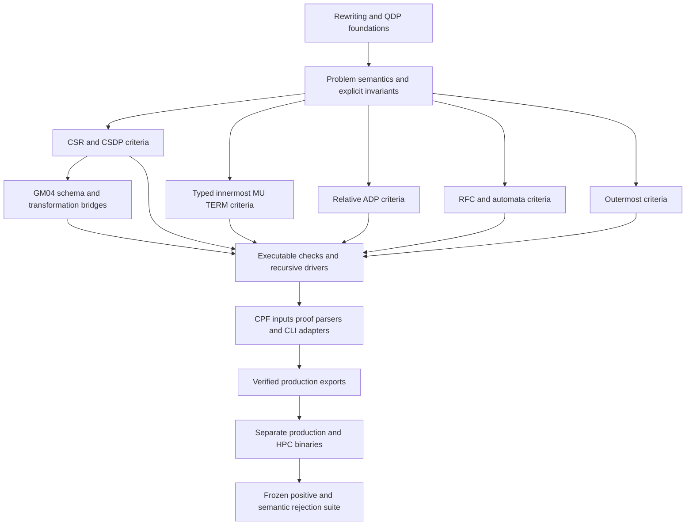

# CeTA consolidation assessment

Historical assessment checkpoint, subsequently approved by the user. Counts and
"not yet" statements below describe that checkpoint. Current implementation
and verification evidence is in [implementation-progress.md](implementation-progress.md).

Review checkpoint: retain the distinct semantic criteria, unify reusable plumbing only after coverage is established, and remove no theorem or executable branch yet. The isolated `consolidated` branch starts at CeTA `e52c7ce1a198b2b3c2873e8aacdab19a3552c5d1`. No checker, theorem, parser, generated module, or build target has been changed.

This assessment separates source inspection from verified equivalence. The inventory includes every changed theory at every pinned development tip, with declaration, checker, soundness, parser-tag and generated-module discovery indexes. Those indexes are lexical candidates, not a completed processor-to-theorem coverage proof. Unresolved mappings explicitly block restructuring their paths.

## Frozen evidence

[snapshot.json](snapshot.json) records the full hashes, original locations, private copies and snapshot time. [supplemental-snapshot.json](supplemental-snapshot.json) records Ferrum source archives, toolchain identifiers and excluded development files. Private evidence is under this worktree's `target/consolidation-snapshot/`; it is not committed and must be retained with the worktree. Selected proof/input artifacts will become durable repository data in the next stage.

| Source | Pinned identity | Interpretation |
| --- | --- | --- |
| Downloaded CeTA 3.9 | `8e6e5f9545eb0d566b03efd403c771bf3f2400c5` | Comparison baseline |
| CeTA main | `e52c7ce1a198b2b3c2873e8aacdab19a3552c5d1` | Consolidated starting tree |
| CeTA-CSR main | `17dbee4b822733cd25235a64178db2ccf590a10e` | Comparison history, not merged |
| Production checker | SHA256 `19a4a6f14eb1d07891d149f8c8b464228c0044fa7b3f874b77eadb974cba8f73` | Frozen executable; source linkage reported by the campaign ledger, not rebuilt here |
| Latest producing Ferrum | `b8b572ffba7dbb68f1ec58ef4ff918189f760a83` | Binary SHA256 `e258a26f5204e25acba63e207ad1a04df9ab2ccc15c28a6f6e31dd359631bec7` |
| Current search oracle | SHA256 `b72d202f253aa8bcae86748c58dabb8a667ff45c874e1b8485d95af94edd79fd` | v634 copy; eligibility still requires independent audit |
| Complete replay Ferrum | `afb4acbd86412fbac3d27d5cd005ea5b3391d622` | Earlier complete replay, distinct binary retained |
| Complete replay oracle | SHA256 `207329cbeea5aa692d1b22d89ae466d1a2fb4823ee14194964e5f1ddce0147ed` | v591 copy; do not substitute v634 when reproducing this run |

Ferrum HEAD moved during initial discovery. The frozen HEAD source archive is the revision recorded in `snapshot.json`, separately from both producing revisions. Binary equality does not prove that the binary was built from that HEAD. No later live changes enter this assessment's inventory.

The 40 frozen configuration/audit files include `unified-final-v593` and incremental strip, fresh-RFC, projection, pattern and SRS replays. The complete replay receipts report 1,701 SRS roots and 1,759 protected Standard/Innermost/CSR roots. These are historical receipt counts, not newly reproduced results. Later incremental unions must remain separate exact root sets. Original-input correspondence, strict oracle-only provenance and two checks by the pinned checker still gate every selected proof.

Relative-ADP examples and the retained Com/graph checks in `docs/development-builds.md` are useful candidate evidence, but do not establish strict witness-free replay provenance. Outermost source exists; an eligible outermost replay has not been established. Neither category may disappear from the gap report.

Excluded uncommitted work includes CeTA-CSR `thys/ROOT`, `thys/Outermost_CDP_Ext/`, and `thys/CSR_Checker/Extensions/CSR_Innermost_Unhiding_Proofs.thy`. The committed unhiding theory under `Muterm_Ext/` remains in scope. The similarly named untracked file is not evidence that the committed one is obsolete.

## Main branches and development histories

[branches.json](branches.json) records all tip hashes, file deltas and unmerged commit lists. Snapshot refs are under `refs/consolidation-snapshot/`; no existing branch was advanced. Five independent Git repositories contribute 21 distinct tips and 25 named branch refs, excluding `consolidated` itself.

The mains have four CeTA-only commits and nine CeTA-CSR-only commits. `git cherry` identifies none as exact patch equivalents. This does not establish semantic difference or equivalence.

| History | Proposed treatment |
| --- | --- |
| CeTA `ae4ffbe`, `1606d51`, `5f47396`, `e52c7ce` | Preserve nested CSR removal, GM04 integration and generalized residual behavior during reconciliation; verify callers and guards against CSR main |
| CSR `def4623`, `4cda18b`, `b018e39` | Retain complete/full GM04 semantics and Standard integration; compare sanitizing and signature premises explicitly |
| CSR `58632f3`, `3ddffbd`, `68bf6e9`, `73662ec` | Retain standalone improved/nonminimal/relative/typed-MU-TERM inputs and explicit GM04 child bridges |
| CSR `1872a8c`, `17dbee4` | Retain absolute RFC residual criterion and general rule strengthening with their restrictions |
| AAECC tips `40ff181`, `67e9e34` | Compare innermost-switch and QDP-to-SRS implementations with CSR main; do not replay entire historical branches over newer integration |
| CSR development/integration/frontier/MU-TERM tips | Preserve snapshots; classify each remaining delta by source and theorem dependencies before taking it |
| GM04 standard/full/integration and max-monus tips | Candidate historical implementations, not automatically obsolete; retain until source callers and accepted forms are accounted for |
| `efa7cda` RFC/innermost cleanup | Inspect direct innermost DP and RFC-representation changes separately; the branch name does not authorize wholesale integration |
| Separate old RFC and relative-ADP repositories | Comparison evidence only until any capability absent from both mains is demonstrated |
| Duplicate downloaded/development repository | Historical comparison; no deletion or replacement of another worktree |

## Semantic decisions

Paths below refer to pinned CeTA-CSR main unless stated otherwise. [families.json](families.json) supplies the machine-readable family decisions and coverage obligations; [source-inventory.json](source-inventory.json) supplies every discovered declaration and source blob. The proposed categories are semantically necessary, general theorem with corollaries, executable optimization, compatibility adapter, and redundant/obsolete candidate. A removal candidate is not a proven redundancy.

| Family | Classification and action | Required distinctions and evidence |
| --- | --- | --- |
| Ordinary and relative QDP problems | Semantically necessary; keep | Preserve the full `(nfs,m,P,Pw,Q,R,Rw)` tuple. `Ceta_Problem_Spec` distinguishes ordinary, relative, improved CSR and typed MU-TERM inputs. Empty Q, arbitrary Q and innermost normal-form obligations cannot be interchanged. Termination and nontermination of DP problems are explicitly not dual. |
| Core nonminimal CSR DP checking | Semantically necessary; keep | `check_standalone_nonminimal_csr_dp` accepts only `Guarded_CSR_DP_Existing`; its theorem concludes `finite_csr_dpp`. Other guarded processors require minimality. Keep the actual replacement map. |
| Minimal improved CSR and RTA08 | Semantically necessary criteria; keep, extract shared lemmas later | `check_standalone_minimal_csr_dp_sound` concludes CSR minimal-chain finiteness while its internal ordinary DP flags remain `False,False`. Source well-formedness, fresh marked/unhiding definitions and an unsharp unhiding symbol are checked. A residual P need not contain all original construction pairs. RTA08 pair and usable-rule constructions remain separate. |
| Conservative CSR | Specialized criterion/corollary candidate; keep | Share only after proving the precise implication from its conservative variable/position conditions to the proposed general interface. Similar successful roots do not justify replacing it with improved CSDPs. |
| Direct innermost and unhiding constructions | Semantically necessary pending equivalence; defer restructuring | Hidden and collapsing pairs, projection/marking rules and active-position coverage are different obligations. Compare `direct_innermost_csdp_coverage`, RTA08 and typed exact-unhiding constructions rather than matching names. |
| Typed innermost MU-TERM | Semantically necessary; keep | `check_standalone_muterm_typed_dp_sound` has its own typed minimal-chain conclusion. Checks include orthogonality, unmarked source signature, exact B, and equality of marked/source replacement maps. Preserve collapsing pairs and unhiding bridges. Do not coerce this input to ordinary/improved CSR DPs. |
| Usable rules and executable closure | Executable optimization candidates; keep semantic variants | Improved QCS, minimal/RTA08, full MU-TERM and innermost MU-TERM closure predicates have different premises. Reuse closure implementation only with a refinement theorem for each mode. A recursive usable-rule step must preserve the correct ambient/source R; filtering R again can change the obligation. |
| CSR graph, SCT, subterm and reduction pairs | Distinct criteria plus shared implementations; keep | Freeze pair/rule sets, map, minimality and recursive child context. Separate active SCT, frozen/hybrid/mixed subterm and order-domain obligations. No replacement based on benchmark overlap. |
| Guarded list measures | General theorem plus specializations candidate; keep then unify | The generic symbolic guard checker proves backward truth/rule conditions. Specialized terminal checks may become wrappers only after their guard and measure hypotheses are discharged against the generic theorem. Preserve nested improved-DP use separately from terminal root use. |
| Semantic labeling | Distinct certificate representations; keep | Finite and ordinary labeling have distinct model/labeling obligations. Record resulting signature/map and recursive child checks; do not conflate finite enumeration with unrestricted semantics. |
| Innermost switch and AAECC | General theorem/corollary candidate; defer equivalence | Match the source strategy, Q constraints and preservation of the residual DP problem against both branch versions. A full-rewriting proof is not automatically an innermost-chain adapter in both directions. |
| GM04 complete, full and sanitizing transformations | Shared schema with distinct theorem interfaces; keep | Separate transformation direction, sanitizing phase, freshness and source-signature restrictions. `gm04_finite_schema_top_pairs_q_sig` supplies an explicitly Q-restricted DP result. Extended signatures require a global source proof; signature-restricted source termination is insufficient by itself. |
| Standalone GM04 DP and nested TRS bridges | Compatibility adapters with verified discharge; keep | `check_gm04_standalone_dp_proof_sound` checks the CSR child and actual DP child. `gm04_residual_assm` requires exactly one unconditional finite assumption, matching pairs modulo variable renaming, equivalent NF terms, no weak pairs/strict rules and the permitted weak-rule subset. The TRS wrapper requires one unconditional DP premise. These are not global assumption acceptance. |
| QDP to SRS | Specialized transformation; keep | `zantema_qdp_to_srs_impl_sound` permits arbitrary nfs/m but has empty Pw, Q, R and Rw and checked productive/transfer pair shapes. No general-Q extension follows from its name. |
| Relative ADPs | Semantically necessary; keep and later move out of dev | Preserve annotations, main/base distinction, valid variable-reposition functions and fixed selected witnesses. The graph checker computes children and requires exact child count. Erasure and Com reduction pairs are distinct obligations; DRP1 requires an annotation-free transformed base. |
| RFC and match bounds | General theorem/refinement candidates; keep distinct residual contracts | Initial-language coverage, automaton closure, right-linearity and signature assumptions remain explicit. `SN_from_RFC_delete_and_absolute_residual` combines RFC relative termination with global termination of the residual K. The absolute adapter drops weak rules only under that theorem; it cannot be substituted for the relative residual contract without changing the child obligation. |
| Rule strengthening | General theorem with SRS use; keep | `rule_strengthens` requires every original rule to be one actual rewrite step of the proposed system. `rule_strengthening_tt` rejects nonempty Q and weak rules. The theorem is general TRS simulation, not a benchmark-specific string trick. |
| Outermost RZ | Semantically necessary; keep, defer restructuring without replay | The checker verifies quasi-left-linearity, a fresh grounding constant and automaton marker, exact positive-arity flat-map coverage, valid linear non-redex patterns and automaton cover. Its child is full TRS termination of generated rules; its conclusion is outermost termination. Neither is interchangeable with ordinary or CSR termination. |
| XML/CPF forms and CLI | Compatibility adapters; keep | Preserve existing forms and CLI split-input behavior. Unknown nodes remain errors. Parser aliases are candidates for shared constructors only after context and source-input meaning match. |
| Historical generated output | Regeneration artifact; remove superseded output only after export | Generated Haskell is not a semantic reconciliation source. Rebuild ordinary, relative-ADP and RFC production exports from the retained theories, then regenerate; never hand-merge conflicting generated code. |

## Retained architecture

Keep explicit semantic problem types rather than flattening all criteria into one generic DP flag set. Within each feature family, separate semantics and theorem interfaces, executable refinement/side-condition checks, and CPF/CLI adapters. Shared helper proofs should sit below those families; specialized assumptions stay visible in corollaries and adapter soundness theorems.

This is the proposed layering, not a claim that the current session graph already has this shape. The inventory retains lexical imports; resolving the full session-qualified dependency graph is required before moving theories.

Concrete keep/unify/remove/defer decisions:

- **Keep:** all currently committed main-branch capabilities, all semantic mode distinctions above, accepted CPF forms, and independent relative/RFC integration targets.
- **Unify after proof and coverage:** list/set and renaming helpers, reusable closure algorithms with mode-specific refinement theorems, generic guarded-measure specializations, schema/freshness checks and parser constructor aliases. No semantic unification is approved by source resemblance alone.
- **Remove now:** nothing. Later candidates are superseded generated outputs and duplicated historical adapters whose callers, certificate forms and soundness dependencies have been replaced and verified.
- **Defer:** uncommitted outermost/CDP and alternate unhiding work; unexplained development deltas; every path without eligible positive and semantic rejection coverage; claimed equivalences between full/innermost/minimal/nonminimal/typed criteria.

## Coverage and the next implementation gate

[coverage-gaps.json](coverage-gaps.json) reports 115 changed theory paths, 184 unique theory blobs and 1,088 lexical checker/parser candidates across 21 tips. These are source-inventory counts, not runtime branches or distinct processors. No positive proof has yet been admitted to the compact suite, no semantic negative has been validated, and HPC coverage has not been measured. The family inventory is a review-level mapping; a complete context-sensitive per-processor map remains a prerequisite to restructuring.

After review, build the suite before semantic consolidation:

1. Freeze the full candidate inputs/certificates separately, audit strict witness-free oracle-only provenance and original-input correspondence, and check each eligible proof twice with the frozen production checker. Regenerate incomplete provenance using the archived producing source and private dependencies/oracle. Historical counts alone confer no eligibility.
2. Parse CPF with context: root/nested/standalone, full/innermost/CSR/relative/SRS, minimality, exact Q/P/R/Pw/Rw, map, signature restrictions, order domain/representation, terminal/residual and recursive composition. Unknown nodes create gaps. Instrument a separately built Haskell checker and require agreement with production.
3. Freeze the obligation denominator. Select by root count, then measured time and compressed size: deterministic greedy upper bound, bounded exact search, explicit optimality status. No arbitrary count cap. Unattained obligations remain visible and block their refactoring.
4. Mutate selected genuine proofs one side condition at a time. Validate the intended semantic failure; crashes, timeouts and XML parsing errors do not count. Retain source hashes and expected reasons.
5. Reconcile the two mains semantically in passing batches. Run focused Isabelle gates, compact twice-check positives and paired negatives, production/HPC agreement, coverage preservation, full retained corpus at milestones and fresh complete replay at baseline/final. Compare exact roots and outcomes, including NO proofs. Quarantine any unsound baseline acceptance.

The compact suite, minimizer, HPC runner, full replays and consolidated feature commits are deliberately not claimed at this assessment checkpoint. No minimum-cardinality result or runtime/theorem coverage result exists yet.

## Build isolation and acceptance

Reserve `target/consolidation-build/` for private Isabelle user home/heaps, exports, GHC output and binaries. Use unique identifiers per milestone, separate production/HPC output directories and no writes to existing heaps. Seed compatible dependencies by private copy or copy-on-write, never hard links that a build can mutate. The snapshot identifies Isabelle2025-2, GHC 9.6.7 and the available AFP sources; the earlier Git identity was subsequently found to belong to the enclosing Ferrum repository. The private AFP copy is now pinned by file contents. Build compatibility requires checking session options and dependency identities.

Do not invoke the existing Makefile in a parent worktree: its `ceta-relative-adp` target replaces `ceta`. The consolidated build must preserve separate ordinary, relative-ADP and RFC executables until a verified combined entry point exists. Relative production export and `RFC_Absolute_Ext` are explicit gates in addition to `Proof_Checker`/`Code`.

Before each build/replay launch, measure `MemTotal - MemAvailable` and refuse launches above 2 TiB. Record theory/export/GHC/certification timings, treating timeouts as failures. Pin replay ceilings from measured private baselines with at least 20% headroom; retain the complete replay environment (including direct-filter and semantic-labeling settings) rather than copying only command-line timeouts. Investigate compact regressions over 20% with controlled repeats.

## Deferred upstream series

Only after the consolidated structure passes the final gates, reconstruct independent patches for: problem semantics/interfaces; CSR/CSDP and typed innermost criteria; transformation/residual bridges; relative ADP; RFC/match bounds; outermost; parser/CLI compatibility; session/build organization; regenerated exports and regression data. Keep each patch's theorem, executable, parser, genuine positive and rejection evidence reviewable together. This is a future outline, not an upstream-ready series.

## Historical review checkpoint (approved)

The user subsequently authorized implementation. The approved scope is the
retained architecture and conservative keep/unify/remove/defer decisions, the
provenance-audited regression suite, and consolidation batches whose coverage
and verification gates pass. Deployment and merging into parent branches remain
outside this task.

## Assessment verification

`python3 tools/consolidation/verify.py` verifies the 53 private evidence artifacts, 184 source blob identities, snapshot refs, complete family assignment, inventory counts and unchanged production source tree. It also checks that both original main worktrees retain their recorded branch refs and tracked diffs. [verification.json](verification.json) records the result and scope.

`inventory.py` and `families.py` regenerate the review indexes from pinned Git objects; repeated generation produced identical bytes. All four helper scripts passed Python syntax parsing. `snapshot.py` is a one-shot capture tool and refuses to overwrite an existing snapshot; do not rerun it to absorb parent-thread changes. These checks validate the assessment package, not Isabelle proofs or certificate acceptance.
